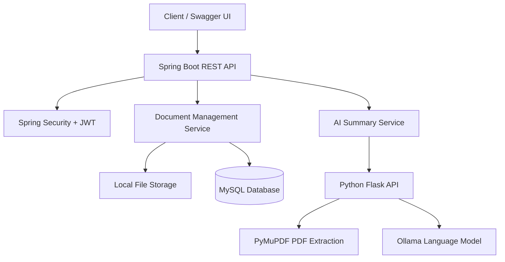

# Document Management System with AI PDF Summarization

A backend application built with **Java 17, Spring Boot, Spring Security, JWT, MySQL, Python Flask, and Ollama**. The project provides document management REST APIs, metadata persistence, authentication, and AI-powered summarization for text and PDF documents.

**Repository:** [GitHub – Document Management System](https://github.com/kharatjayshri1712-blip/document-management-system)

## Features

- **JWT Authentication:** Register and authenticate users and protect API endpoints.
- **Document Management:** Upload, download, list, and delete documents through REST APIs.
- **File Metadata:** Store and retrieve document names, content types, sizes, and upload timestamps using MySQL and Spring Data JPA.
- **AI Text Summarization:** Send document text to a Python Flask service for summarization.
- **AI PDF Summarization:** Extract PDF text using PyMuPDF and generate summaries with a locally hosted Ollama language model.
- **Input Validation and Error Handling:** Handle invalid requests, missing files, empty document text, and AI service failures.
- **API Documentation:** Explore and test endpoints using Swagger UI and OpenAPI.
- **Automated Tests:** Spring Boot tests using JUnit 5 and MockMvc.

## Technology Stack

| Technology | Purpose |
|---|---|
| Java 17 | Backend programming |
| Spring Boot 3.3.0 | REST API development |
| Spring Security and JWT | Authentication and authorization |
| Spring Data JPA | Database persistence |
| MySQL | User and document metadata storage |
| Python and Flask | AI summarization service |
| PyMuPDF | PDF text extraction |
| Ollama — Qwen 2.5 1.5B | Local language model for summarization |
| Maven | Build and dependency management |
| Swagger / OpenAPI | API documentation |
| JUnit 5 and MockMvc | Automated testing |

## Architecture



### Request flow

1. A client sends a request to the Spring Boot REST API.
2. Spring Security checks authentication for protected endpoints.
3. Document operations store files locally and persist metadata in MySQL.
4. For summarization, Spring Boot sends text or a PDF filename to the Python Flask service.
5. The Flask service extracts PDF text when necessary and requests a summary from Ollama.
6. The generated summary or an error response is returned to the client.

## API Endpoints

| Method | Endpoint | Description |
|---|---|---|
| POST | `/ai/summarize` | Summarize supplied text |
| POST | `/ai/summarize-pdf` | Summarize a PDF by filename |
| GET | `/files` | List available files |
| GET | `/files/metadata` | Retrieve file metadata |
| POST | `/files/upload` | Upload a document |

Authentication, download, and deletion endpoints are also available. Open Swagger UI to view their exact routes, request formats, and security requirements.

## Example API Requests

### 1. Summarize text

**Request:** `POST /ai/summarize`

```json
{
  "text": "Java is a programming language used to develop applications."
}
```

**Example response:**

```json
{
  "summary": "Java is a programming language for application development."
}
```

### 2. Summarize a PDF

**Request:** `POST /ai/summarize-pdf`

```json
{
  "fileName": "sample.pdf"
}
```

**Example response:**

```json
{
  "fileName": "sample.pdf",
  "summary": "The document discusses its main topics and key points."
}
```

The PDF must exist in the project's `uploads/` directory. Actual summaries depend on the document content and the language model output.

## Prerequisites

Install the following software before running the project:

- Java JDK 17
- MySQL Server
- Python 3
- Maven, or use the Maven wrapper included in the repository
- [Ollama](https://ollama.com/download)
- Git

## Setup and Installation

### Step 1: Clone the repository

```bash
git clone https://github.com/kharatjayshri1712-blip/document-management-system.git
cd document-management-system
```

### Step 2: Create the MySQL database

Open MySQL and run:

```sql
CREATE DATABASE document_management_db;
```

Configure the database username and password using environment variables. Do not commit real credentials to GitHub.

In Windows PowerShell:

```powershell
$env:DB_USERNAME = "root"
$env:DB_PASSWORD = "your_local_mysql_password"
```

Replace the example password with your actual local MySQL password.

The application reads the database settings from `src/main/resources/application.properties`.

### Step 3: Install Python dependencies

From the project root, run:

```powershell
python -m venv .venv
.\.venv\Scripts\Activate.ps1
python -m pip install -r requirements.txt
```

If PowerShell does not allow virtual environment activation, use the Python executable inside `.venv` directly to install the requirements.

### Step 4: Prepare Ollama

Download and install Ollama, then pull the model used by the application:

```bash
ollama pull qwen2.5:1.5b
```

Ensure Ollama is running and the model is available locally before testing AI summarization.

### Step 5: Start the Python AI service

From the project root, create the local upload directory if it does not exist:

```powershell
New-Item -ItemType Directory -Force uploads
```

Start Flask:

```powershell
python ai_service.py
```

The service runs at `http://127.0.0.1:5000`.

Keep this terminal open while using the AI summarization endpoints.

### Step 6: Start the Spring Boot application

Open a second terminal in the project root and configure the database environment variables in that terminal as well.

Run:

```powershell
.\mvnw.cmd spring-boot:run
```

Alternatively, if Maven is installed and configured:

```bash
mvn spring-boot:run
```

### Step 7: Open Swagger UI

Once Spring Boot has started, open:

[http://localhost:8080/swagger-ui/index.html](http://localhost:8080/swagger-ui/index.html)

Use the available authentication endpoints to obtain a JWT token, then authorize protected requests in Swagger UI.

To test PDF summarization, place a suitable PDF in the local `uploads/` directory before sending the request.

## Running Tests

Run the automated Spring Boot tests from the project root:

```powershell
.\mvnw.cmd test
```

The current project test milestone includes 12 passing Spring Boot tests. Controller tests using mocked services do not necessarily require a running MySQL instance, Flask service, or Ollama model.

## Configuration and Security

- Keep database passwords, JWT signing secrets, AWS credentials, and other sensitive values out of version control.
- Use environment variables for local secrets.
- Keep uploaded documents, generated summaries, and build output out of Git.
- Never upload private documents or confidential information to a public repository.

## Current Implementation Notes

- Document uploads currently use local filesystem storage.
- AWS S3 configuration and service code are present in the project; verify and enable the S3 upload flow before relying on cloud storage.
- AI summarization depends on the Python Flask service and a locally running Ollama model.
- The application is currently configured for local development rather than a production deployment.

## Future Improvements

- Complete and test AWS S3 document storage.
- Add Docker and Docker Compose for repeatable local setup.
- Improve integration and end-to-end test coverage.
- Add pagination and document search.
- Introduce API Gateway and service discovery.
- Explore asynchronous processing using Kafka.
- Deploy the application to a cloud platform.
- Add CI/CD automation.

## Project Goal

This project demonstrates practical backend development skills in REST API design, JWT authentication, relational database persistence, document management, Python service integration, AI-powered PDF summarization, input validation, exception handling, and automated testing.
